# 不换路由只提优先级？北京电信家庭宽带国际加速服务（163Plus）晚高峰双线对照实测

<style>
.telecom163-table {
  max-width: 100%;
  overflow-x: auto;
  margin: 1rem 0 1.25rem;
  border: 1px solid var(--separator, #dde4ea);
  border-radius: 14px;
}
.telecom163-table table {
  display: table;
  width: 100%;
  min-width: 34rem;
  max-width: none;
  margin: 0;
  border-radius: 0;
}
.main-content:has(.telecom163-tariff) :is(h2, h3) {
  scroll-margin-top: 5rem;
}
img.telecom163-tariff {
  display: block;
  width: auto;
  max-width: min(100%, 440px);
  max-height: 65vh;
  height: auto;
  margin: 1rem auto;
}
</style>

晚高峰访问海外节点，开通北京电信“家庭宽带国际加速服务”（俗称 163Plus）能带来多大改善？本次实测在北京时间 21–23 点对比两条配置相同的家宽，涵盖六组空载 MTR 路由追踪与四组采用 BBR 的单连接 iperf3 反向下载测试。**实测显示，163Plus 在四条测试路径上的单连接平均下载速率均显著提升，六组 MTR 末跳丢包率均降至 0%–0.6%；但代价与局限也同样清晰：末跳排队抖动（StDev）明显放大，且受制于海外接入段质量，部分路径仍会出现短时断流或高频重传。**

## 一、业务内容与开通后的变化

北京电信“家庭宽带国际加速服务”（方案编号：**25BJ100098**）的官方资费与规则如下：

- **资费**：30 元/月，首月按天折算，限 200M 及以上 FTTH 家庭宽带办理。
- **办理与退订**：可通过 10000 号或线下渠道办理，订购后立即生效；可通过营业厅或 10000 号退订，次月生效。
- **有效期**：24 个月。到期前 30 日双方均未提出异议，每次自动续展 24 个月；无在网要求，无违约责任。


*图 1：北京电信“家庭宽带国际加速服务”官方资费说明（方案编号：25BJ100098）*

除资费单列出的条款外，实测开通该业务后还有三项直接影响使用方式的变更（已向电信官方确认）：**IPv4 变为 CGNAT 内网地址、IPv6 被收回，且该业务与公网 IP 包互斥。** 下文分别用“普通家宽”和“163Plus 家宽”指代两条测试线路。

## 二、业务原理：同路由体系下的 C–I 段保障

此业务开通后仍走普通 163（AS4134）路由体系，核心变化在于 **C–I 段的转发保障**。C 是国内核心层，I 是国际出口层。海外服务器向北京家宽发送数据时，流量沿 I → C 方向通过这一段。

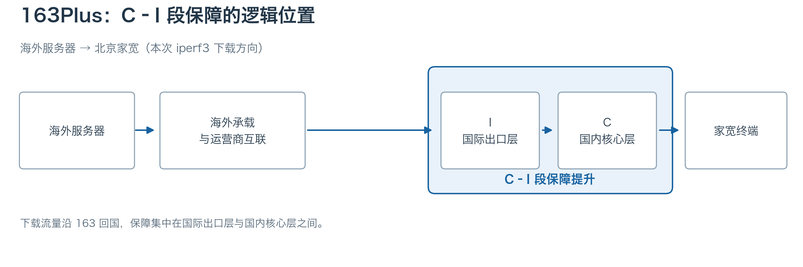

*图 2：海外下载方向上的 C–I 段*

C–I 段拥塞是普通 163 家宽晚高峰访问海外的主要瓶颈之一。163Plus 的核心机制是在不改变原有 AS4134 骨干路由的前提下，通过 QoS 提高用户流量在 C–I 段拥塞时的转发优先级与队列待遇。不过，海外流量进入国内前还需经过国际接入层（F）与国际交换层（X/S）。如果瓶颈出在海外上游互联端口（Peering/Transit）或海外 PoP 接入段（X–F），仅靠提升国内 C–I 段的转发优先级并不能拓宽海外侧的可用带宽，也不能改变跨境绕行路径。

## 三、测试方法与路径

两条宽带在**北京时间 21–23 点晚高峰**同时对比，有线设备和客户端配置相同。MTR 在空载时单独运行，保留逐跳记录并汇总末跳统计；ICMP 响应丢包率不等于 TCP 转发丢包率。iperf3 采用 BBR，单 TCP 流反向下载 15 秒，速率和 Retr 均取服务端 sender 日志。

```sh
iperf3 -t 15 -R -c <测试服务器>
```

<div class="telecom163-table" markdown="1">

| 本文标签 | 实际测试起点与路径 | iperf3 |
|---|---|---|
| LAX 163 · AWS PDX | AWS PDX → LAX 接入 163 | 有 |
| FRA 163 · AWS FRA | AWS FRA → FRA 接入 163 | 有 |
| LAX Arelion | LAX 节点 → Arelion → 163 | 有 |
| FRA TATA | FRA 节点 → TATA → 163 | 有 |
| FRA 163 · AWS LHR | AWS LHR → FRA 接入 163 | 未测 |
| FRA Cogent · AWS SIN | AWS SIN → Cogent（经 FRA）→ 163 | 未测 |

</div>

表中按**流量进入 163 骨干网前的接入点与上游运营商**命名标签，例如 AWS 新加坡样本经 Cogent 绕行法兰克福接入 163，故标记为 `FRA Cogent · AWS SIN`。

## 四、MTR：六组回程路由与逐跳表现

以下六组回程 MTR 截图中，左侧均为 163Plus 家宽，右侧为普通家宽。各组两条线路使用相同的海外上游和电信国际接入方向，部分具体接口存在分流。国内骨干与北京城域网（AS4847）中出现的不同接口 IP，可由 ECMP 等多路径转发机制解释。163Plus 在六组记录中均比普通家宽少 1–3 跳到达目标。开通后的 CGNAT 改变了末端接入形态，但具体跳数差异仍需结合局端拓扑判断。

### LAX 163 · AWS PDX

[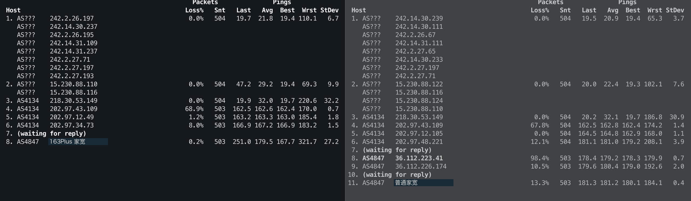](assets/mtr-lax-pdx.png)

两条线路在洛杉矶同经 `218.30.53.149` 与 `202.97.43.109` 入网。第 4 跳近 68% 的响应丢包未延续至后续节点，符合骨干路由器控制面 ICMP 限速的特征。真正拉开差距的是末跳：普通家宽丢包率达 **13.3%**，163Plus 仅为 **0.2%**。

### FRA 163 · AWS FRA

[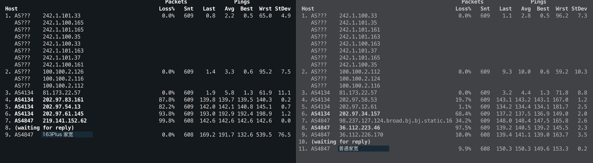](assets/mtr-fra-aws.png)

两侧在第 3 跳同经电信法兰克福节点 `81.173.22.57`（AS4134）入网，第 4 跳起分流，并于第 7 跳进入北京 AS4847。163Plus 第 7 跳的 99.8% 响应丢包同样未延续至末跳，符合控制面限速的特征。末跳丢包率为 **0.0%**，普通家宽为 **9.9%**。

### LAX Arelion

[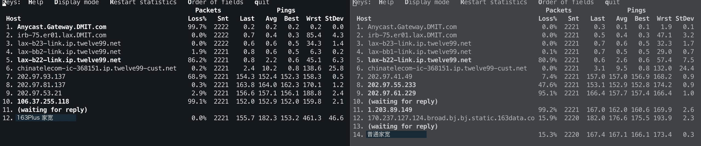](assets/mtr-lax-arelion.png)

两侧从 DMIT 网关出发后均经 Arelion（`twelve99.net`）在洛杉矶 `lax-b22` 汇合，并通过同一互联接口（`chinatelecom-ic-368151`）交接至电信 163。两侧各进行约 2,220 次探测，普通家宽末跳丢包率为 **15.3%**，163Plus 为 **0.0%**。

### FRA TATA

[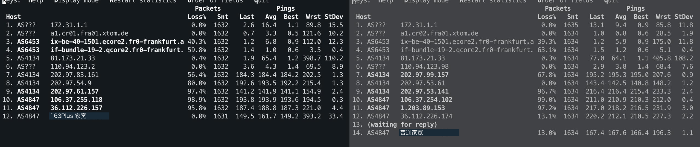](assets/mtr-fra-tata.png)

两侧由 xTom 法兰克福出发，经相同的两跳 TATA（AS6453）核心节点后，在第 5 跳统一交接至电信 `81.173.21.33`。普通家宽末跳丢包率为 **13.0%**，163Plus 降至 **0.0%**。

### FRA 163 · AWS LHR

[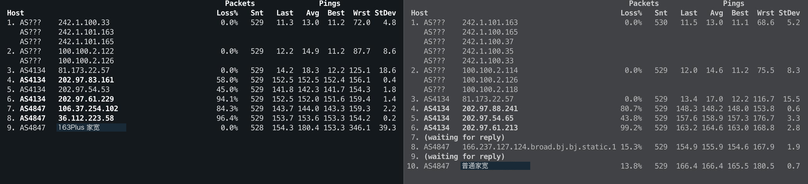](assets/mtr-fra-lhr.png)

伦敦样本在第 3 跳同样汇聚至法兰克福 `81.173.22.57` 接入 163，与 AWS FRA 样本重合。其中 163Plus 侧在第 3、4 跳与法兰克福样本走向一致。末跳丢包率由普通家宽的 **13.8%** 降至 **0.0%**。

### FRA Cogent · AWS SIN

[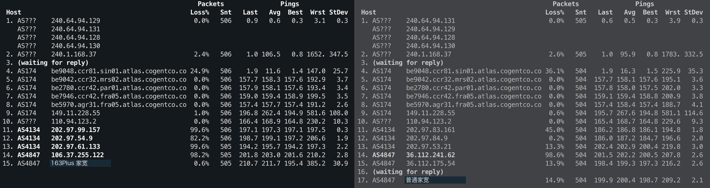](assets/mtr-fra-cogent.png)

起点为 AWS 新加坡，两侧第 4–10 跳完全重合：沿 Cogent（AS174）经马赛（`mrs02`）、巴黎（`par01`）绕行至法兰克福（`fra05`），在第 10 跳经 `110.94.123.2` 接入电信。由于共用同一套 163 路由体系，163Plus 虽然将晚高峰末跳丢包从 **14.9%** 压低至 **0.6%**，但无法改变新加坡绕行欧洲的物理路径，平均 RTT 依然高达 **211.7 ms**（普通家宽为 **200.4 ms**）。

### 六组末跳对照

<div class="telecom163-table" markdown="1">

| 路径 | 线路 | Loss% | Snt | Avg / ms | StDev / ms |
|---|---|---|---|---|---|
| LAX 163 · AWS PDX | 163Plus 家宽 | 0.2% | 503 | 179.5 | 27.2 |
| LAX 163 · AWS PDX | 普通家宽 | 13.3% | 503 | 181.2 | 0.4 |
| FRA 163 · AWS FRA | 163Plus 家宽 | 0.0% | 608 | 191.7 | 76.5 |
| FRA 163 · AWS FRA | 普通家宽 | 9.9% | 608 | 150.3 | 0.2 |
| LAX Arelion | 163Plus 家宽 | 0.0% | 2221 | 182.3 | 46.6 |
| LAX Arelion | 普通家宽 | 15.3% | 2220 | 167.1 | 0.3 |
| FRA TATA | 163Plus 家宽 | 0.0% | 1631 | 161.7 | 33.4 |
| FRA TATA | 普通家宽 | 13.0% | 1634 | 167.6 | 1.1 |
| FRA 163 · AWS LHR | 163Plus 家宽 | 0.0% | 528 | 180.4 | 39.3 |
| FRA 163 · AWS LHR | 普通家宽 | 13.8% | 529 | 166.4 | 0.7 |
| FRA Cogent · AWS SIN | 163Plus 家宽 | 0.6% | 505 | 211.7 | 30.9 |
| FRA Cogent · AWS SIN | 普通家宽 | 14.9% | 504 | 200.4 | 2.1 |

</div>

汇总六组末跳数据，两类流量呈现出鲜明的**“高丢包、低抖动”与“低丢包、高抖动”**反差：普通家宽末跳丢包率高达 **9.9%–15.3%**，但成功返回样本的 StDev 仅为 **0.2–2.1 ms**。163Plus 有四组末跳丢包清零（另两组仅 **0.2%** 和 **0.6%**），但六组 StDev 全部升至 **27.2–76.5 ms**。例如 AWS FRA 的单次探测最高 RTT 达 539.5 ms，拉高了整体均值与离散度。

这种“高丢包、低抖动”与“低丢包、高抖动”的反差，符合两类流量在晚高峰拥塞点受到不同队列处理的特征。普通家宽若触发硬限速（Policing）或尾部丢包（Tail Drop），超限或遇到队满的探测包会被直接丢弃，不计入 RTT 统计。成功返回的探测包若未经历深队列等待，StDev 就会很低。163Plus 若获得更高的调度优先级或更深的队列缓冲（Buffer），原本会被丢弃的包便有机会等到转发。这能减少末跳丢包，也会让排队较久的响应进入 RTT 统计。各次探测的排队时延（Queuing Delay）相差越大，StDev 就越高。

## 五、iperf3：四条路径的单连接下载

<div class="telecom163-table" markdown="1">

| 路径 | 普通 / Mbps | 163Plus / Mbps | 普通 Retr | 163Plus Retr |
|---|---|---|---|---|
| LAX 163 · AWS PDX | 0.138 | 114 | 36 | 0 |
| FRA 163 · AWS FRA | 0.415 | 78.6 | 50 | 1,815 |
| LAX Arelion | 0.205 | 138 | 49 | 417 |
| FRA TATA | 61.5 | 233 | 10,228 | 41,909 |

</div>

### LAX 163 · AWS PDX

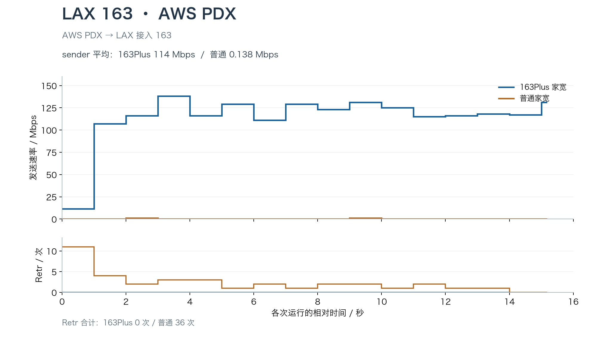

```text
【163Plus 家宽】
[  5] local 172.26.12.11 port 5201 connected to 【163Plus 家宽】 port 1523
[  5]   0.00-1.00   sec  1.38 MBytes  11.5 Mbits/sec    0    450 KBytes
[  5]   1.00-2.00   sec  12.8 MBytes   107 Mbits/sec    0   6.50 MBytes
[  5]   2.00-3.00   sec  13.9 MBytes   116 Mbits/sec    0   6.50 MBytes
[ ID] Interval           Transfer     Bitrate         Retr
[  5]   0.00-15.18  sec   206 MBytes   114 Mbits/sec    0            sender

【普通家宽】
[  5] local 172.26.12.11 port 5201 connected to 【普通家宽】 port 33360
[  5]   0.00-1.00   sec  0.00 Bytes  0.00 bits/sec   11   9.84 KBytes
[  5]   1.00-2.00   sec  0.00 Bytes  0.00 bits/sec    4   5.62 KBytes
[  5]   2.00-3.00   sec   128 KBytes  1.05 Mbits/sec    2   4.22 KBytes
[ ID] Interval           Transfer     Bitrate         Retr
[  5]   0.00-15.18  sec   256 KBytes   138 Kbits/sec   36            sender
```

普通家宽约 15 秒仅发送 256 KiB，分布在两个完整的一秒区间，每个区间 128 KiB。163Plus 在第一秒后维持 107–138 Mbps，全程零重传。两条线路平均速率分别为 **0.138 Mbps 和 114 Mbps**。从日志末列的拥塞窗口（Cwnd）看，163Plus 从第 2 秒起稳定在 6.50 MiB，普通家宽则反复重传，Cwnd 始终只有 1.41–9.84 KiB。

### FRA 163 · AWS FRA

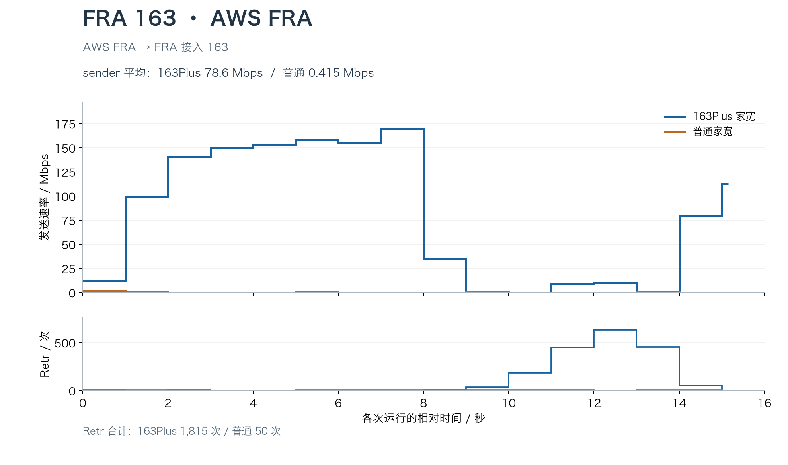

```text
【163Plus 家宽】
[  5] local 172.26.14.138 port 5201 connected to 【163Plus 家宽】 port 1474
[  5]   7.00-8.00   sec  20.2 MBytes   170 Mbits/sec    0   3.18 MBytes
[  5]   8.00-9.00   sec  4.25 MBytes  35.7 Mbits/sec    2   1.41 KBytes
[  5]   9.00-10.00  sec  0.00 Bytes  0.00 bits/sec   37   18.3 KBytes
[  5]  10.00-11.00  sec  0.00 Bytes  0.00 bits/sec  184   56.2 KBytes
[  5]  11.00-12.00  sec  1.12 MBytes  9.44 Mbits/sec  450    132 KBytes
[  5]  12.00-13.00  sec  1.25 MBytes  10.5 Mbits/sec  634    107 KBytes
[  5]  13.00-14.00  sec  0.00 Bytes  0.00 bits/sec  453    105 KBytes
[  5]  14.00-15.00  sec  9.50 MBytes  79.7 Mbits/sec   55   2.42 MBytes
[ ID] Interval           Transfer     Bitrate         Retr
[  5]   0.00-15.15  sec   142 MBytes  78.6 Mbits/sec  1815            sender

【普通家宽】
[  5] local 172.26.14.138 port 5201 connected to 【普通家宽】 port 50696
[  5]   7.00-8.00   sec  0.00 Bytes  0.00 bits/sec    2   4.22 KBytes
[  5]   8.00-9.00   sec  0.00 Bytes  0.00 bits/sec    2   4.22 KBytes
[  5]   9.00-10.00  sec   128 KBytes  1.05 Mbits/sec    2   2.81 KBytes
[  5]  10.00-11.00  sec  0.00 Bytes  0.00 bits/sec    3   7.03 KBytes
[ ID] Interval           Transfer     Bitrate         Retr
[  5]   0.00-15.15  sec   768 KBytes   415 Kbits/sec   50            sender
```

163Plus 全程均值 **78.6 Mbps**（普通家宽仅 **0.415 Mbps**），但中途出现明显断流：第 2–8 秒速率维持在 141–170 Mbps，第 8–9 秒期间，`Cwnd` 从 `3.18 MiB` 骤降至 `1.41 KiB`（约 1 个 MSS），随后连续两秒发送量归零。窗口收缩到这一水平后，可维持的在途数据量极低，11–14 秒间仍伴随上千次重传缓慢恢复窗口。

### LAX Arelion

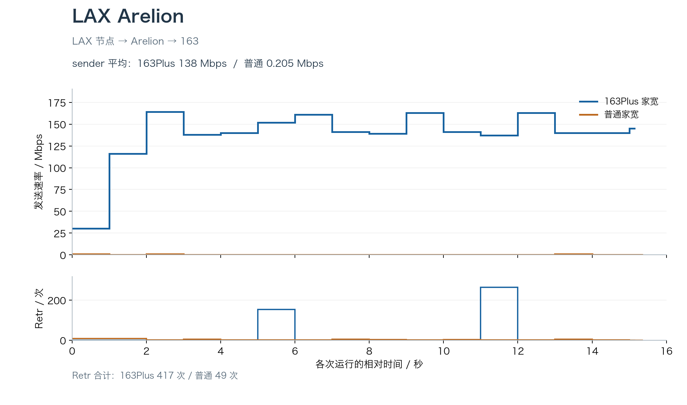

```text
【163Plus 家宽】
[  5] local 174.136.204.72 port 5201 connected to 【163Plus 家宽】 port 1521
[  5]   4.00-5.00   sec  16.8 MBytes   140 Mbits/sec    0   7.95 MBytes
[  5]   5.00-6.00   sec  18.1 MBytes   152 Mbits/sec  153   5.59 MBytes
[  5]   6.00-7.00   sec  19.2 MBytes   161 Mbits/sec    0   5.59 MBytes
…
[  5]  10.00-11.00  sec  16.8 MBytes   141 Mbits/sec    0   5.59 MBytes
[  5]  11.00-12.00  sec  16.4 MBytes   137 Mbits/sec  264   3.91 MBytes
[  5]  12.00-13.00  sec  19.4 MBytes   163 Mbits/sec    0   3.91 MBytes
[ ID] Interval           Transfer     Bitrate         Retr
[  5]   0.00-15.16  sec   249 MBytes   138 Mbits/sec  417            sender

【普通家宽】
[  5] local 174.136.204.72 port 5201 connected to 【普通家宽】 port 44202
[  5]   4.00-5.00   sec  0.00 Bytes  0.00 bits/sec    1   5.62 KBytes
[  5]   5.00-6.00   sec  0.00 Bytes  0.00 bits/sec    2   2.81 KBytes
[  5]   6.00-7.00   sec  0.00 Bytes  0.00 bits/sec    2   5.62 KBytes
…
[  5]  10.00-11.00  sec  0.00 Bytes  0.00 bits/sec    3   2.81 KBytes
[  5]  11.00-12.00  sec  0.00 Bytes  0.00 bits/sec    2   5.62 KBytes
[  5]  12.00-13.00  sec  0.00 Bytes  0.00 bits/sec    2   1.41 KBytes
[ ID] Interval           Transfer     Bitrate         Retr
[  5]   0.00-15.37  sec   384 KBytes   205 Kbits/sec   49            sender
```

163Plus 全程平均 **138 Mbps**（普通家宽 **0.205 Mbps**）。与 AWS FRA 不同的是，尽管 163Plus 在第 5–6 秒和 11–12 秒分别出现 153 次和 264 次重传，但 BBR 的 `Cwnd` 仅从 `7.95 MiB` 先后回调至 `5.59 MiB` 和 `3.91 MiB`。按该路径约 180 ms RTT 估算，维持 100 Mbps 吞吐所需的带宽时延积（BDP）约为 2.15 MiB，窗口仍高于这一水平。两个重传区间的速率分别为 152 和 137 Mbps，未出现发送停顿。

### FRA TATA

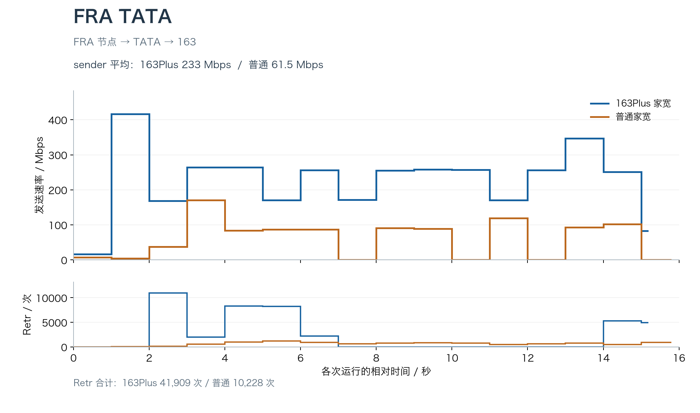

```text
【163Plus 家宽】
[  5] local 45.147.50.23 port 5201 connected to 【163Plus 家宽】 port 2304
[  5]   0.00-1.00   sec  2.00 MBytes  16.8 Mbits/sec    0    403 KBytes
[  5]   1.00-2.00   sec  49.6 MBytes   416 Mbits/sec    0   22.1 MBytes
[  5]   2.00-3.00   sec  20.1 MBytes   169 Mbits/sec  10973   11.6 MBytes
[  5]   3.00-4.00   sec  31.5 MBytes   264 Mbits/sec  2023   1.87 MBytes
[  5]   4.00-5.00   sec  31.5 MBytes   264 Mbits/sec  8305   19.1 MBytes
[  5]   5.00-6.00   sec  20.4 MBytes   171 Mbits/sec  8253   7.29 MBytes
[ ID] Interval           Transfer     Bitrate         Retr
[  5]   0.00-15.19  sec   422 MBytes   233 Mbits/sec  41909            sender

【普通家宽】
[  5] local 45.147.50.23 port 5201 connected to 【普通家宽】 port 58864
[  5]   0.00-1.00   sec   896 KBytes  7.33 Mbits/sec    8   78.8 KBytes
[  5]   1.00-2.00   sec   512 KBytes  4.20 Mbits/sec   28    305 KBytes
[  5]   2.00-3.00   sec  4.50 MBytes  37.7 Mbits/sec  121   1.45 MBytes
[  5]   3.00-4.00   sec  20.4 MBytes   171 Mbits/sec  559   7.42 MBytes
[  5]   4.00-5.00   sec  10.0 MBytes  83.9 Mbits/sec  1000   8.25 MBytes
[  5]   5.00-6.00   sec  10.4 MBytes  87.1 Mbits/sec  1200   8.21 MBytes
[ ID] Interval           Transfer     Bitrate         Retr
[  5]   0.00-15.80  sec   116 MBytes  61.5 Mbits/sec  10228            sender
```

普通家宽发送 **116 MiB**，平均 **61.5 Mbps**，重传 **10,228 次**；163Plus 发送 **422 MiB**，平均 **233 Mbps**，重传 **41,909 次**。163Plus 的吞吐为普通家宽的 **3.8 倍**，发送量为 **3.64 倍**，重传数为 **4.10 倍**。

按发送量折算，普通家宽约 **88 次重传/MiB**，163Plus 约 **99 次/MiB**，后者高约 13%，单位数据量的重传负担处于同一量级。两条线路均经 TATA 接入，海外互联侧是可能的共同瓶颈。在相近的重传负担下，具备国内 C–I 段保障的 163Plus 仍达到普通家宽 **3.8 倍的单流吞吐**。

## 六、总结

晚高峰四组测试中，LAX 163、LAX Arelion 和 FRA 163（AWS FRA）的普通家宽均不足 0.5 Mbps，163Plus 分别达到 **114、138 和 78.6 Mbps**；FRA TATA 则由 **61.5 Mbps** 提升至 **233 Mbps**。

综合来看，北京电信 163Plus 有效缓解了普通 163 家宽晚高峰在 C–I 段的拥塞丢包，让海外单连接 TCP 流量得以顺利撑开窗口起速。但它的作用范围仅限于国内出口段的转发调度：一方面，若海外互联侧或 PoP 节点本身容量不足，传输瓶颈与重传依然存在；另一方面，它不会改变原有的 163 路由走向（如新加坡经 Cogent 绕行法兰克福的路径开通后依然绕行），对时延敏感的场景仍取决于目标节点具体的海外接入路由。

如果你常用欧美的低价服务器，希望晚高峰从这些机器下载时快一些，又用不到 IPv6 和公网 IPv4，我觉得每月花 30 元开通 163Plus 还算划算。此外据我了解，上海电信面向家宽的 CN2 和 163Plus 都已停止新办，北京这项业务如果正好用得上，我建议趁还能办时及时上车开通。

## 参考资料与原始数据

Luminous，[《〖杂谈〗运营商链路简评&鉴别（163/169/CN2等)》](https://luotianyi.vc/4242.html)，2020-08-25。

原始数据附件：

- [六组 MTR 逐跳记录（脱敏）](data/MTR-脱敏完整记录.txt)
- [四组 iperf3 服务端日志（脱敏）](data/iperf3-脱敏原始记录.txt)
